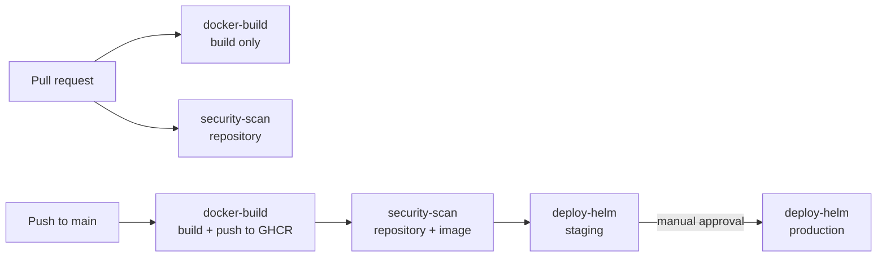

# GitHub Actions templates

Reusable GitHub Actions workflows for container builds, security scanning, Terraform and Helm
deploys. Call them from any repository and get a complete pipeline in about 40 lines of YAML.

Maintained by [GonService](https://gonserviceit.com.br/devops) · [Português](#em-português)



## Workflows

| Workflow | What it does | Key inputs |
| --- | --- | --- |
| [`docker-build.yml`](.github/workflows/docker-build.yml) | Buildx build with GitHub cache, branch/PR/semver/sha tags, SBOM and provenance; pushes to GHCR when `push: true` | `image-name`, `context`, `dockerfile`, `platforms`, `push` |
| [`security-scan.yml`](.github/workflows/security-scan.yml) | Trivy scan of dependencies, IaC and secrets (results in the Security tab), plus optional image scan with a severity gate | `image-ref`, `severity`, `fail-on-findings` |
| [`terraform.yml`](.github/workflows/terraform.yml) | `fmt`, `validate` and `tflint` on every run; `plan` with AWS OIDC, posted (and updated) as a PR comment | `working-directory`, `terraform-version`, `run-plan` |
| [`deploy-helm.yml`](.github/workflows/deploy-helm.yml) | `helm upgrade --install --atomic --wait` into a GitHub environment, with automatic rollback and one deploy at a time per environment | `environment`, `release`, `chart`, `namespace`, `values-file`, `image-tag` |

Outputs of `docker-build.yml`: `image`, `digest` and `version`, so later jobs scan and deploy
exactly the image that was built.

## Usage

```yaml
jobs:
  build:
    uses: GonService/github-actions-templates/.github/workflows/docker-build.yml@v1
    with:
      push: ${{ github.event_name == 'push' }}
```

Complete examples:

- [`examples/app-pipeline.yml`](examples/app-pipeline.yml) — build, scan, deploy to staging and,
  after approval, to production.
- [`examples/terraform-pipeline.yml`](examples/terraform-pipeline.yml) — Terraform checks and plan
  comment on every pull request.

### Requirements

- **GHCR push:** the caller needs `permissions: packages: write`.
- **Security tab:** `permissions: security-events: write` (free for public repositories; private
  repositories need GitHub Advanced Security).
- **Terraform plan on AWS:** an IAM role trusted for GitHub OIDC, passed as `AWS_ROLE_ARN`
  and `AWS_REGION` secrets. No long-lived keys.
- **Helm deploy:** a `KUBECONFIG_B64` secret per environment (`base64 -w0 kubeconfig`), ideally
  scoped to a single namespace. Mark `production` as a protected environment to require approval.

## Versioning

Pin a major tag (`@v1`). Breaking changes only ship in a new major version. CI lints every
workflow with [actionlint](https://github.com/rhysd/actionlint) and runs the build and scan
templates against a fixture on every pull request.

## Em português

Workflows reutilizáveis do GitHub Actions para build de containers, varredura de segurança,
Terraform e deploy com Helm. Um repositório chama os templates e ganha um pipeline completo:
build e scan em todo pull request; build, push, scan da imagem, deploy em homologação e, com
aprovação, em produção a cada merge na `main`. Veja os exemplos na pasta [`examples/`](examples).

Precisa disso no seu projeto? A GonService monta e mantém o pipeline:
[gonserviceit.com.br/devops](https://gonserviceit.com.br/devops) ·
[contato@gonserviceit.com.br](mailto:contato@gonserviceit.com.br)

## License

[MIT](LICENSE)
